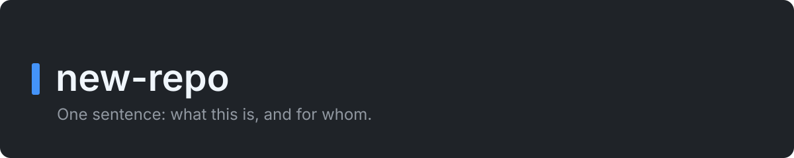

> [!NOTE]
> **This is a template.** To start a repository from it, follow
> [Starting from the template](docs/starting-from-the-template.md). Delete
> this note when you finish the last step.

<p align="center">
  
</p>

<p align="center">
  <a href="https://github.com/Bimmiest/new-repo/actions/workflows/ci.yml"></a>
  <a href="https://github.com/Bimmiest/new-repo/actions/workflows/security.yml"></a>
  <a href="https://scorecard.dev/viewer/?uri=github.com/Bimmiest/new-repo"></a>
  <a href="LICENSE"></a>
</p>

<!--
How to write this README (CONTRIBUTING, "Documentation"):
- Write it in ASD-STE100 Simplified Technical English.
- Keep it to the fundamentals. CI fails a README of more than 200 lines.
- Put each topic that needs more than a few lines in its own file under
  docs/, and add a row for it in the Documentation table.
Delete this comment when the sections below are written.
-->

# new-repo

<!-- One sentence: what this is, and for whom. -->

## Highlights

<!-- Three to five bullets. Each bullet is one thing a user gets. -->

- 

## Overview

<!--
One or two short paragraphs:
- What the product does, and how it does it at the top level.
- How mature it is: pre-release, or a version. Name the caveats a user must
  know before they rely on it. Delete a caveat in the change that removes it.
- What it is not: the permanent limits, so that a reader finds them here.
-->

## Demo

<!--
Show the product in use: a screenshot, or a short GIF of under 30 seconds.
Put the file in docs/assets/ and show it here as an image. For a
command-line tool, a short terminal recording is a good demo.
-->

## Usage

```bash
# One or two commands that show the core job.
```

## Installation

```bash
nvm use    # the Node version in .nvmrc
npm ci
npm run build
```

Requirements: Node, at the version in [`.nvmrc`](.nvmrc).
<!-- Add each platform or service that the product needs. -->

## Documentation

| Document | What it holds |
|---|---|
| [CONTRIBUTING.md](CONTRIBUTING.md) | The rules: issues, branches, commits, pull requests, decisions, security and releases |
| [docs/development.md](docs/development.md) | How to set up a checkout, run the gates, and the traps |
| [docs/ci.md](docs/ci.md) | Each CI job, what makes it fail, and what to do when a check fails only in CI |
| [docs/testing.md](docs/testing.md) | The rules for tests |
| [docs/code-style.md](docs/code-style.md) | The rules for the layout, the lint, the types and the code comments |
| [docs/dependencies.md](docs/dependencies.md) | The rules for dependencies, and how to review a Dependabot pull request |
| [docs/documentation.md](docs/documentation.md) | Where each text goes, the line limits, the topic types and the STE rules |
| [docs/repository-settings.md](docs/repository-settings.md) | The repository settings that are not files, and that `settings.yml` checks each week |
| [docs/starting-from-the-template.md](docs/starting-from-the-template.md) | How to make a new repository from this template |
| [docs/adr/](docs/adr/README.md) | The decisions, and why we made them |
| [CHANGELOG.md](CHANGELOG.md) | What changed for a user, newest first |
| [SECURITY.md](SECURITY.md) | How to report a vulnerability, and what is in scope |
| [CODE_OF_CONDUCT.md](CODE_OF_CONDUCT.md) | The Contributor Covenant, enforced through the security contact |

<!-- Add a row for each file under docs/ that holds a topic. -->

## Contributing and feedback

To report a bug or to suggest a change, open an issue. Before you open a pull
request, read [CONTRIBUTING.md](CONTRIBUTING.md).

## Licence

[MIT](LICENSE).
<!--
Add a row for each LICENSE-* file of third-party material that this
repository redistributes: what it covers and what it obliges. CI's
docs-check fails if a LICENSE-* file is not linked here.
-->
